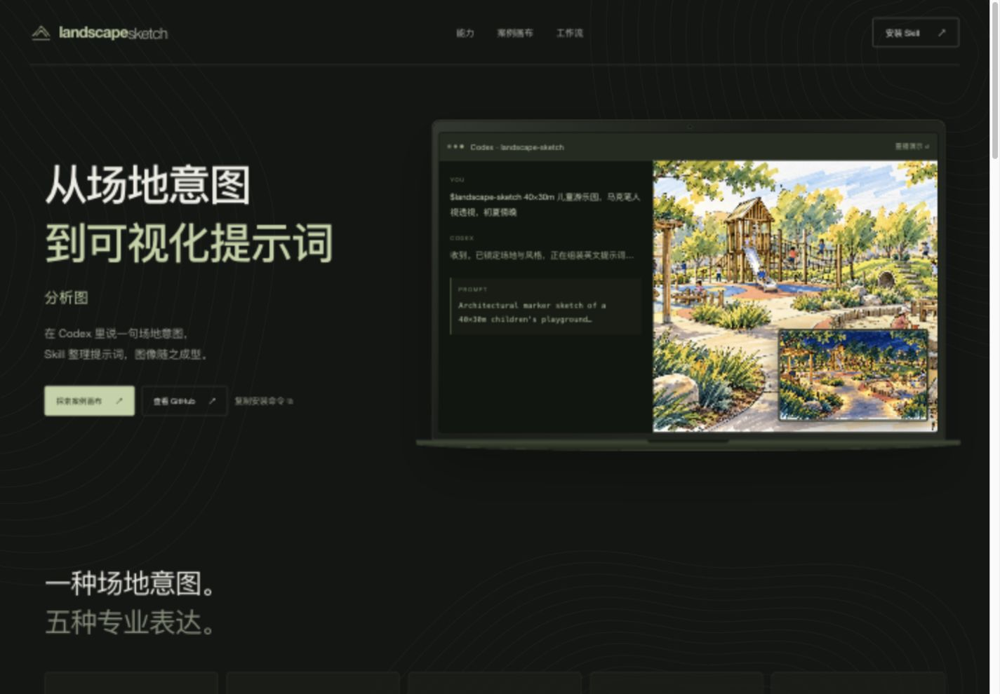
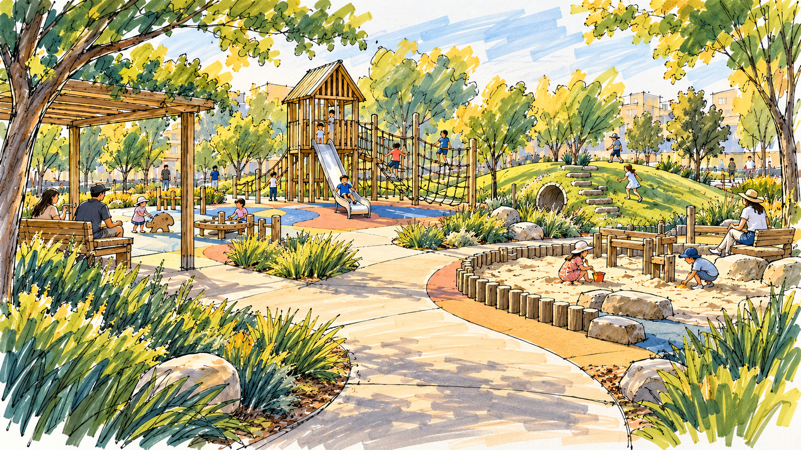
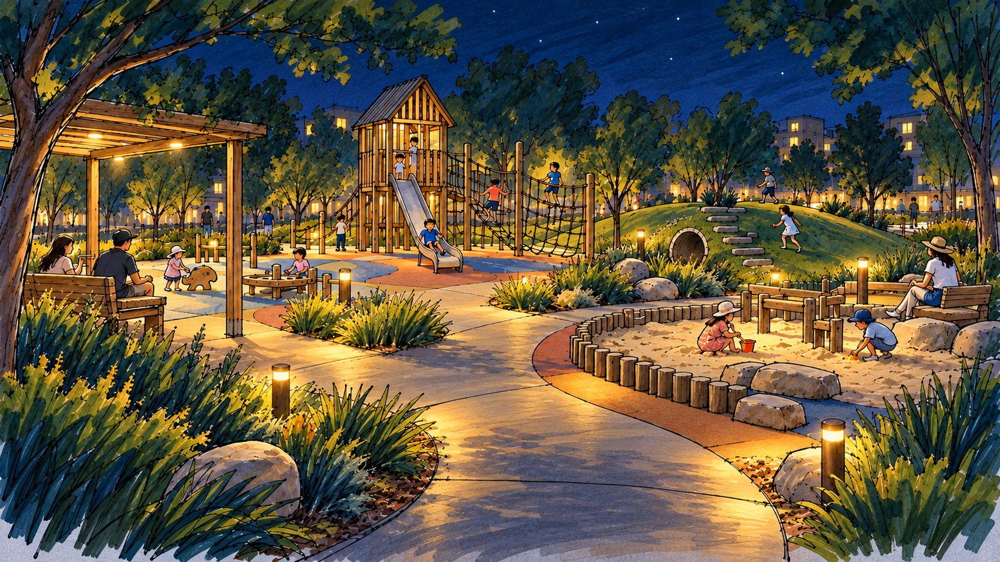

# Landscape Sketch · 景观手绘 Skill

将景观设计想法整理成适用于图像模型的英文提示词，附中文说明、可调参数和图纸检查清单。适合公园、广场、滨水空间、庭院、街道及儿童游乐场的概念表达。

An instruction-based Agent Skill for landscape visualization prompts: site plans, perspective sketches, sections/elevations, concept diagrams and seasonal mood studies.

## 展示落地页

[浏览展示页源码](docs/index.html) · [页面文件与本地预览说明](docs/README.md)

展示 Skill 的专业工作流、Codex 对话演示与日夜景风格对比。下载仓库后直接打开 `docs/index.html` 即可浏览，无需安装依赖。

[](docs/index.html)

## 示例：儿童游乐园

同一场景的日景与夜景，保留布局和镜头，采用马克笔手绘表现。示例由 AI 图像工具生成。

| 初夏日景 | 夜景照明 |
| --- | --- |
|  |  |

查看 [日景提示词与说明](examples/children-playground-day-prompt.md) / [夜景调整提示词](examples/children-playground-night-prompt.md)。示例图不是工程验证结果。

## 能做什么

- 彩色平面图：边界、分区、道路、植物及标注位置。
- 手绘透视与鸟瞰：空间层次、人物尺度、构图与光影。
- 剖面与立面：相对高差、剖切表达与植物层次。
- 概念分析图：流线、分区、视线及日照示意。
- 四季与氛围：固定空间布局，调整植物季相和时段。
- 风格：马克笔、水彩淡彩、写实渲染。

默认输出是英文提示词，不绑定特定图像模型；实际生成或编辑图片需要宿主提供图像工具或用户自行使用图像模型。本 Skill 自身不包含 API 调用脚本，也不需要配置密钥。

## 项目级安装（Codex）

在你的目标项目根目录执行：

```sh
git clone https://github.com/buu206/landscape-sketch-skill.git /tmp/landscape-sketch-skill
mkdir -p .agents/skills/landscape-sketch
cp /tmp/landscape-sketch-skill/SKILL.md .agents/skills/landscape-sketch/
cp -R /tmp/landscape-sketch-skill/workflows /tmp/landscape-sketch-skill/aesthetics .agents/skills/landscape-sketch/
```

如果临时目录或目标 Skill 已存在，请改用新的临时目录，或先检查已有内容再更新。该安装只复制 Skill 所需文件；示例可在仓库中查看。Codex 通常会自动发现新增 Skill；若未显示，可重启应用。

项目级目录依据 [OpenAI 官方 Skills 文档](https://learn.chatgpt.com/docs/build-skills)。其他支持 Agent Skills 的工具可以使用相同文件，安装位置请遵循各自文档。

## 如何触发

显式调用：

```text
$landscape-sketch 帮我生成一个 40×30 米儿童游乐园的马克笔手绘透视图提示词。
```

也可以直接描述需求，例如“帮我写景观彩平提示词”或“生成滨水步道四季氛围图提示词”。是否自动调用由宿主根据 Skill 的 description 判断，并非简单的关键词开关。

更多示例：

```text
$landscape-sketch 设计一个口袋公园彩平，水彩风格，包含休息区和雨水花园。
$landscape-sketch 为同一庭院生成四季对比提示词，保持布局和镜头一致。
$landscape-sketch 把这张儿童游乐园效果图改成夜景，保留布局和手绘风格。
```

最后一个示例需要同时提供参考图和可用的图像编辑工具。

## 工作方式

1. 收集场地类型、规模、季节与时段、表现风格、视图类型；每次最多询问两个问题，缺项可使用默认值。
2. 按图纸类型读取一个工作流和对应风格文件。
3. 组装风格前缀、场景描述、技术约束和负面词。
4. 交付英文提示词、中文说明及 2–3 个可调参数；生成图像后再检查尺度、层次、材质和光影。

默认值：约 40×30 米口袋公园、初夏傍晚、马克笔、人视透视。用户明确提供的信息优先。

## 文件结构

```text
landscape-sketch-skill/
├── SKILL.md
├── workflows/
│   ├── plan-view.md
│   ├── perspective-sketch.md
│   ├── section-elevation.md
│   ├── concept-diagram.md
│   └── seasonal-mood.md
├── aesthetics/
│   ├── marker-sketch.md
│   ├── watercolor.md
│   └── realistic-render.md
├── docs/                    # 展示落地页与压缩素材
├── examples/
├── README.md
└── LICENSE
```

## 使用边界

AI 图只能用于概念表达。尺寸、竖向、植物配置、照明和游乐设施设计须由设计师校核，不能直接作为施工图。未提供测量或分析数据时，不应虚构精确标高、日照计算或工程结论。

## 贡献与许可

欢迎提交 Issue 或 Pull Request，补充实际案例和工作流改进。修改工作流时请同时检查 SKILL.md 中的引用路径，并保留用户明确需求的优先级。

以 [MIT License](LICENSE) 开源。
